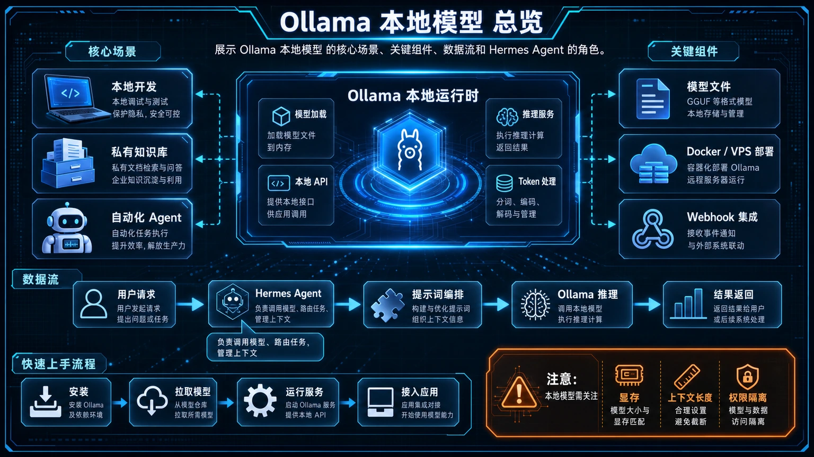
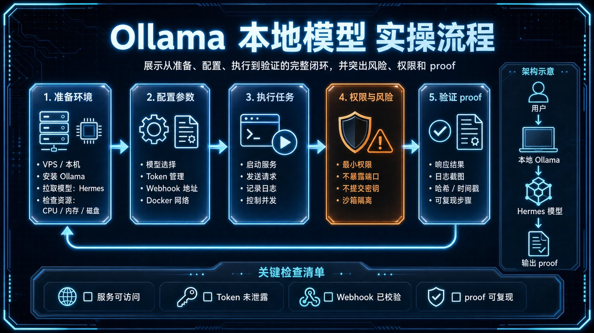

<a id="13-ollama-本地模型让-hermes-完全免费跑起来"></a>

# 🦙 13-Ollama 本地模型：接入步骤与成本、隐私边界

> 💡 **速答**：先安装 Ollama 并验证本地模型，再在 `hermes model` 选 **Custom endpoint**，填写 `http://127.0.0.1:11434/v1` 和 `ollama list` 中的精确模型名。固定 Hermes v0.22.5 的工具工作流要求至少 64,000 token 上下文；需要同步配置 Ollama 服务端与 Hermes，并核对实际内存。本文不保证最低显存、速度或零总成本。

> 2026-10-26 局部文档复核：接入与 64K 要求对照固定 Hermes v0.22.5；Ollama 设置对照当前官方文档。本轮没有安装 Ollama、下载模型、测 GPU／CPU 性能或调用付费 API。旧图是概念示意，图中路由、费用、性能不作为可运行配置或实测。

本地推理可减少云端模型 token 费用，但仍有设备、电费与维护成本。只有实际使用本地权重时，推理才在本机；Ollama Cloud、搜索、MCP、辅助模型和其他工具可能出网，不能据本地地址承诺整个 Agent 离线。

**和 21-Hermes Agent + Ollama 最快路径 的边界**：
- 这一页 = **原理篇**：任务选模、上下文与内存边界、混搭策略、隐私边界、何时退回云端
- [21-Hermes Agent + Ollama：本地部署最快路径](./21-Hermes%20Agent%20与%20Ollama%20最快路径.md) = **速通篇**：另一条接入路径，实际用时取决于安装、下载与硬件
- 建议：先读这一页理解边界 → 再用 21 跑通 → 跑一周后回来调优



---

## 👀 适合谁

- 有可用本地算力，愿意按模型量化、上下文长度和并发验证资源的人
- 关心数据隐私，不想把公司代码或客户对话发给 OpenAI / Anthropic
- 想按任务手动选择本地或云端模型，分别记录质量和成本
- 已经在玩 Ollama，想把它接到 Hermes 上做真正的 Agent 工作

**前提条件**：
- Hermes 已经能正常用云端模型对话
- 你大致清楚自己机器的显存大小
- 知道 [04-按任务选择模型：三层控费与实测指南](./04-月费8美金三层模型级联省钱指南.md) 的任务分档思路（不是自动级联配置）

**不适合谁**：
- 尚未确认模型能否在目标上下文和硬件上运行
- 无法接受实际测得的 CPU／GPU 耗时或内存占用；没有 GPU 本身不等于不能运行
- 想要"完全免费跑得跟 Claude 一样快"——这种好事不存在

---

## 🎯 为什么值得做（以及边界在哪）

先把丑话说清楚：**本地模型 ≠ 云端模型的免费替代**。它是一个有清晰边界的能力。

| 维度 | 云端模型（Claude、GPT、GLM） | 本地模型（Ollama 跑 Qwen、Llama） |
|---|---|---|
| 单次成本 | 按量或订阅等，依服务条款 | 本地推理通常无云端 token 费，硬件／电费另计 |
| 响应速度 | 依模型、负载、网络测量 | 依硬件、量化、上下文、并发测量 |
| 上下文窗口 | 依精确模型和套餐 | 依模型和服务端设置；Hermes v0.22.5 工具工作流至少 64K |
| 工具调用 | 核对模型支持与任务通过率 | 同样核对工具支持与任务通过率 |
| 视觉理解 | 依模型能力 | 依本地多模态模型支持与任务验收 |
| 数据出网 | 推理内容发往选定服务 | 本地权重可本机推理；工具／云模型可能出网 |
| 可用性 | 依 API 与网络状态 | 依机器、服务、模型和资源状态 |
| 复杂推理 | 按实际任务验收 | 按实际任务验收，不能仅按部署位置判断 |

**结论：是否作为主模型，应由自己的质量、耗时、内存和成本记录决定；本文没有提供通用的本地／云端性能排名。**

具体怎么用，看下一节的实操边界。

---

## 🧭 实操边界：什么场景用什么

### ✅ 适合本地模型

| 场景 | 为什么合适 | 推荐模型 |
|---|---|---|
| 总结、改写、翻译 | 先用固定文本检查完整性和错误 | `qwen2.5:7b`、`llama3.1:8b` |
| 离线代码补全 | 确认推理与所用工具的数据边界 | `qwen2.5-coder:7b` |
| 隐私文档问答 | 确认没有云端模型或外部检索 | `qwen2.5:14b`（内存需求实测） |
| Cron 跑"是否要继续"的判断 | 不需要复杂推理 | `qwen2.5:3b`（轻量） |
| 开发/调试 prompt | 烧的是电费不是 Token | 任意 |
| SOUL 人格对话 | 风格化任务，检查风格和约束保持 | `qwen2.5:7b` |

<a id="不适合本地模型"></a>

### ❌ 未通过验证前不直接交付的任务

| 场景 | 为什么不行 |
|---|---|
| 复杂工具调用链（多 Agent 编排） | 需要记录工具成功率和循环／重试 |
| 长文档总结（>32K 输入） | 核对实际上下文与内存，不用 32K 作为通用上限 |
| 视觉理解（截图分析、PDF 解析） | 先核对多模态支持和样本质量 |
| 复杂代码重构 | 用测试和代码审查验收改动 |
| Web Search 后的多源信息综合 | 检查引用、事实和多来源覆盖 |

**实操建议：先用一组固定任务比较，再手动选择通过验收的本地或云端模型；本文没有自动三层路由配置。**



---

## ✍️ 操作步骤：把 Ollama 接到 Hermes

<a id="一键安装linuxmacos"></a>

### 第 1 步：装 Ollama 并拉模型

```bash
# Linux 安装示例；macOS／Windows 使用官方对应安装包
curl -fsSL https://ollama.com/install.sh | sh

# 拉一个 7B 模型（Qwen2.5 中文不错，~5GB 下载）
ollama pull qwen2.5:7b

# 试一下能不能跑
ollama run qwen2.5:7b "你好，请用一句话介绍你自己"
```

确认模型能正常出字。Ollama 默认监听 `127.0.0.1:11434`。

<a id="选-ollama-cloud云托管版或-lm-studio-ollama本地"></a>

### 第 2 步：把 Ollama 注册成 Hermes 的 Provider

**方式 A：用 `hermes model`（推荐）**

```bash
hermes model
# 本地选择 "Custom endpoint (self-hosted / VLLM / etc.)"
# Ollama Cloud 是另一个云端 provider，不用于此本地步骤
# 输入 base_url: http://127.0.0.1:11434/v1
# 不需要 API Key
```

**方式 B：手动改 config.yaml**

```yaml
model:
  default: qwen2.5:7b
  provider: custom
  base_url: http://127.0.0.1:11434/v1
  context_length: 64000  # Ollama 服务端也要配置，不能只改这一项
```

### 第 3 步：验证连通性

先完成下文“调整上下文长度”的服务端设置并重启，确认 Ollama 实际 CONTEXT 不低于 64K；仅填写 Hermes 的配置不能替代服务端设置。

```bash
hermes chat -q "用中文介绍一下你自己"
```

核对实际 provider／模型、响应和日志；记录首 token／总耗时，并用一个可撤销的本地工具任务验收。本文不设置固定秒数为成功保证。

<a id="第-4-步把它加进三层路由关键一步"></a>

### 第 4 步：按任务选择模型（不是自动级联）

参考 [04-按任务选择模型：三层控费与实测指南](./04-月费8美金三层模型级联省钱指南.md)，在新会话里选择已经配置的本地或云端模型，分别运行固定任务。旧文的 `routing.tiers/use_for` 不是本轮固定资料支持的 Hermes 自动级联配置，已撤回。辅助模型、委派与主模型选择分开核对。

本地推理本身不等于整个工作流零费用或离线。若要求本机推理，先确认未选择 Ollama Cloud；当前 Ollama 支持 `OLLAMA_NO_CLOUD=1` 禁用其云功能，但这不会关闭 Hermes 的搜索、MCP 或其他外部工具。

---

## 🔧 性能调优（N 卡用户）

Ollama 默认会用 CUDA（如果有）。可以调的几个参数：

### 1. 指定 GPU

```bash
CUDA_VISIBLE_DEVICES=0 ollama serve
```

<a id="2-调整上下文长度默认-2048-太短"></a>

### 2. 调整上下文长度（服务端与 Hermes 一致）

启动 Ollama 时改：

```bash
OLLAMA_CONTEXT_LENGTH=64000 ollama serve
```

Hermes 使用 OpenAI 兼容的 `/v1` 接口；Ollama 交互中的 `/set parameter num_ctx` 只针对该交互会话，不作为 Hermes API 接入的持久设置。此处使用上面的服务端环境变量；也可按官方说明用带 `PARAMETER num_ctx` 的 Modelfile 创建新模型，并在 Hermes 选择该新模型名。

上述是前台服务的 shell 示例；已运行的系统服务或桌面应用需按对应平台设置并重启，不能在同端口重复启动服务。固定 Hermes v0.22.5 工具工作流要求至少 64K；同步设置 `model.context_length: 64000`，并用 `ollama ps` 核实实际上下文。并发参数不是上下文长度参数。

### 3. 量化版本

显存吃紧的话，用量化版本：

```bash
ollama pull qwen2.5:7b-instruct-q4_K_M
```

量化可能降低权重内存，也可能影响质量；总内存还包括上下文缓存和并发。本轮没有显存或准确度测量，不能给出固定损失比例。

---

## 💡 使用心得

### 心得 1：本地模型 + 工具调用 = 容易翻车

如果目标模型的工具任务频繁失败，记录模型 ID、上下文和失败步骤，再与另一个已配置模型比较；本文没有这些模型间的准确率实验。

在 Hermes 会话中选择已经配置的模型（不是终端 shell 命令）：

```text
/model
```

### 心得 2：长上下文的代价是显存

增加上下文会增加内存需求；用 `ollama ps` 核对 PROCESSOR／CONTEXT，再记录可接受的吞吐。本文不提供无硬件、量化与工作负载记录的 GB 数字。

### 心得 3：Cron 任务跑本地模型最香

Cron 任务多在凌晨跑，不抢你的工作时段显卡。把每天早上的新闻摘要、周报生成、文件整理这种"简单但重复"的任务跑在本地 Ollama 上，是否节省需要计入重试、辅助模型、电费和设备成本，再与原账单比较；本文没有 80% 节省的实测证据。

### 心得 4：用 [SILENT] 抑制空跑

参考“用 Hermes 做每日晨间简报”的 `[SILENT]` 技巧，让本地模型先判断"今天有没有值得报的事"，没有就直接退出。

<a id="心得-5远端访问-ollama-需要-ssh-隧道"></a>
<a id="启动时绑定-0000"></a>
<a id="或者-ssh-隧道更安全"></a>

### 心得 5：远端访问先保持回环监听并使用隧道

Ollama 默认监听回环地址。本机接入不需要更改监听范围；远程开发可用 SSH 隧道：

```bash
# 保持远端 Ollama 回环监听，转发到本机
ssh -N -L 11434:127.0.0.1:11434 user@your-gpu-server
```

---

## ⚠️ 踩坑提醒

### 1. 显存不够模型自动卸载

模型可能全部或部分在 CPU 运行，实际速度依硬件和任务。检查：

```bash
ollama ps
# 看是 GPU 还是 CPU
```

### 2. 模型名带 tag 不一致

`qwen2.5:7b` 和 `qwen2.5:7b-instruct-q4_K_M` 是不同模型。在 Hermes config 里写的模型名必须和 `ollama list` 里显示的完全一致。

### 3. Ollama 服务没启动就跑 Hermes

```bash
systemctl status ollama   # 看服务
ollama serve              # 手动启动（调试用）
```

### 4. 工具调用陷入死循环

7B 模型有时候会反复调同一个工具。在 SOUL.md 里加一条规则：

```text
如果同一个工具连续调用超过 3 次还没拿到结果，直接告诉我"工具调用失败"，不要再试。
```

### 5. base_url 写错

Hermes 的 `model.base_url` 是 **OpenAI 兼容端点**，Ollama 是 `/v1` 结尾：

```yaml
# 对
base_url: http://127.0.0.1:11434/v1

# 错（少 /v1）
base_url: http://127.0.0.1:11434
```

### 6. 用本地模型跑视觉任务

先确认所选模型支持图像，再用自己的样本验收；本轮没有本地／云端视觉质量对照实验。

---

## ✅ 推荐做法

| 做法 | 原因 |
|---|---|
| 先选能支持目标上下文的模型 | 权重大小不是总内存需求 |
| 按任务验收再决定本地或云端 | 不能用部署位置替代质量测试 |
| 手动选择已配置模型 | 三档任务不是自动 routing.tiers |
| 量化后重新验证质量和资源 | 不预设节省或精度比例 |
| Cron 任务优先跑本地 | 凌晨不抢你工作时间 |
| 核对服务端与 Hermes 上下文 | 用实际内存和耗时决定可用性 |

---

## ✅ 过关标准

当你满足以下状态，这篇就算跑通了：

- Ollama 跑起来了，能用 `ollama run` 直接对话
- Hermes 能通过 Custom endpoint 使用本地 Ollama 完成简单任务（比如翻译一段文字）
- 服务端与 Hermes 的上下文设置一致，至少一个目标任务通过验收
- 记录模型／量化、硬件、上下文、工具结果、耗时和成本，并明确云端／外部工具的数据边界

---

## 🔗 实战路径

- [返回实战应用 Hub，继续按任务选择教程](/docs/start/practical)

## ⬅️ 上一步

- [**12-MCP 接入指南：给 Hermes 装上"万能插头"**](./12-MCP%20接入指南.md)

## ➡️ 下一步

- [**14-GitHub PR 自动审查：给仓库配一个不睡觉的 Code Reviewer**](./14-GitHub%20PR%20自动审查.md)

## 📖 出处

本文基于以下来源做了原创中文整理：

- Hermes 官方文档 — [AI Providers: Ollama / LM Studio](https://hermes-agent.nousresearch.com/docs/integrations/providers)
- Ollama 官方文档 — [ollama.com](https://ollama.com/)
- QwenLM 官方 — [Qwen2.5 模型卡](https://qwenlm.github.io/blog/qwen2.5/)
- Hermes 实战 [04-三层模型级联省钱指南](./04-月费8美金三层模型级联省钱指南.md)

## 📌 本轮核对依据与待实测项

- [Hermes v0.22.5 固定 Provider 文档](https://github.com/NousResearch/hermes-agent/blob/bf0203a794a07aac3ff764972ab9087baa4e4f4e/website/docs/integrations/providers.md)：本地 Custom endpoint、Ollama Cloud 分开、64K 工具上下文与服务端设置。
- [Ollama OpenAI 兼容接口](https://docs.ollama.com/api/openai-compatibility)：本地 /v1 与占位 key、功能子集。
- [Ollama 上下文](https://docs.ollama.com/context-length)及 [FAQ](https://docs.ollama.com/faq)：OLLAMA_CONTEXT_LENGTH、服务端上下文、PROCESSOR、云功能和监听范围。

缺少的运行证据：Ollama／Hermes 实际安装版本、模型精确 tag／量化、CPU／GPU／内存、64K 是否成功加载、工具成功率、网络请求和耗时／电费。上述记录完成前，只能称文档接入方案，不能称本站跑通或性能推荐。
