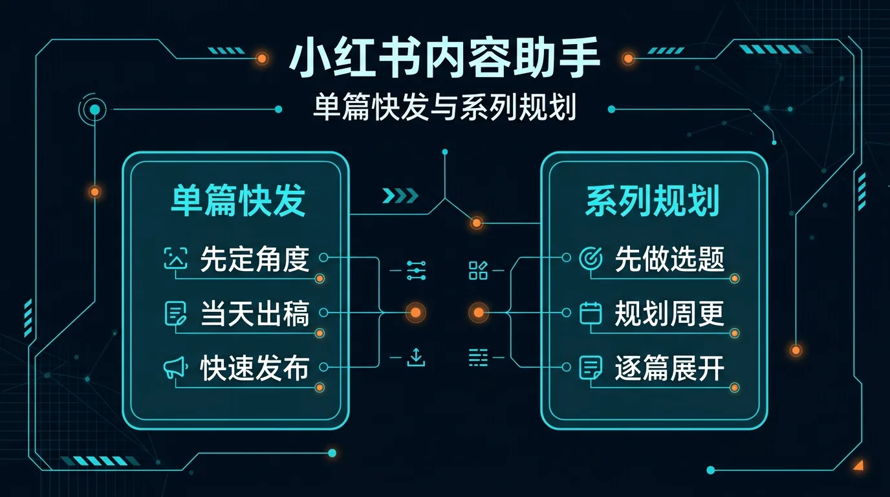
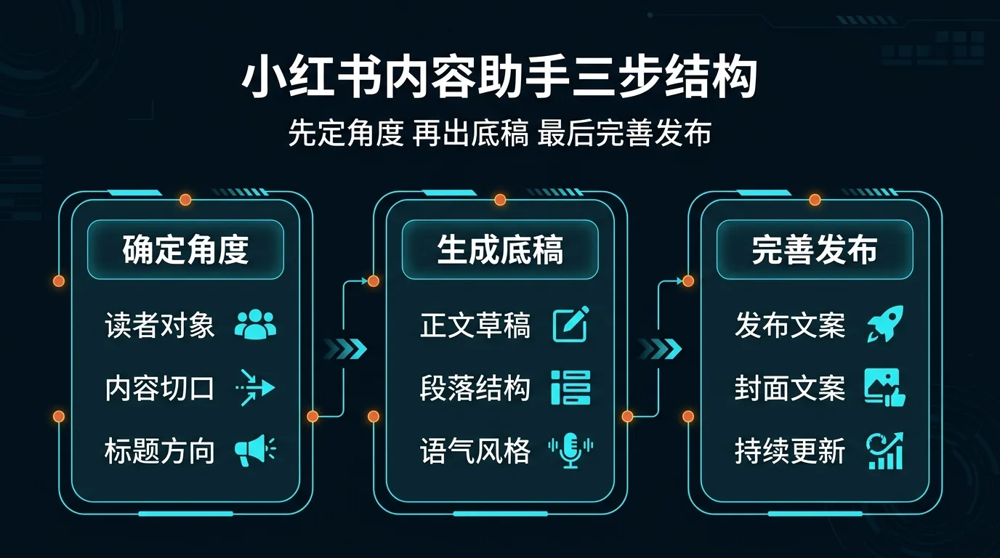
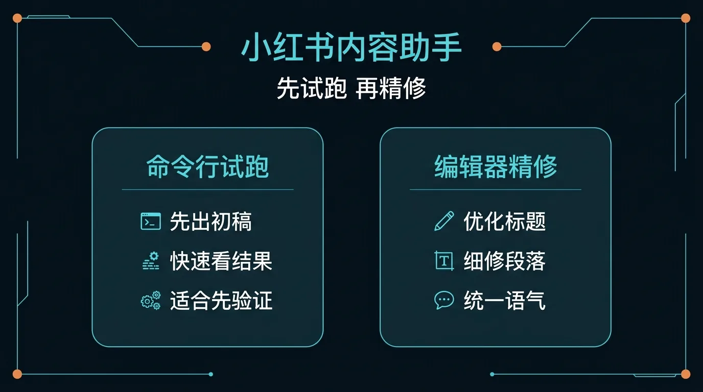

# ✍️ 02-Hermes Agent 小红书助手｜文案草稿与人工发布

用 Hermes Agent 的社区 `xhs-lab` Pack，将已有素材整理成选题、标题和文案草稿。先完成[Hermes 安装与最小回复](/docs/start/get-running/install-hermes)，再从[Pack 页面](/packs/xhs-lab)选择单人或团队模式。本页介绍的是独立的社区内容工作流，与小红书平台内置 AI 助手分别理解。

**本页边界（2026-11-16）**：核对了仓库中的 Pack、安装脚本和样例，尚未完成本轮“资料复核 → 文案 → 配图 → 人工发布”的真实媒体闭环验收。现有样例是格式参考，配图提示不是图片文件，审校模型给出 pass 也不能代替人的发布决定。不承诺完成时间、平台审核通过或流量效果。

## 👤 适合谁，先准备什么

适合有可核实素材、愿意审稿的独立开发者、个人创作者和小团队。若手中只有产品名称而无事实、体验或来源，先补材料，再让助手写稿；不要让它编造使用经历、销量、收益或客户评价。

开始前确认：

- Hermes 能完成最小问答，当前模型、费用与文件目录明确；失败先看[模型接入排障](/docs/issues/provider-endpoint)。
- 已选择单人或团队 Pack，并知道它安装到哪个 profile；找不到技能时看[Skills 与插件排障](/docs/issues/tools-skills-mcp)。
- 输入只包含自己有权提供的材料；需要外部模型或图片服务时，另行核对授权、资料范围和费用。

## 📝 输入模板：先给事实和约束

下面是可复制的需求模板，**不是已执行案例**。将方括号替换为自己的资料；缺失字段明确写“待补”。

```text
任务：围绕一个主题写一篇待人工审校的小红书草稿。
主题：[一个明确的问题或产品使用场景]
读者：[具体是谁，正遇到什么问题]
已核实事实：[本人体验、数据或来源链接；没有就写待补]
可用素材：[截图/照片/文章及使用权限，附来源和日期]
目标：[解释问题、记录过程或介绍功能]
约束：[字数、语气、不能公开的内容、不能作出的承诺]
输出：3 个标题候选、正文、封面短句、配图建议、待核实清单。
不得补造经历、数据、评价或实际运行结果；没有证据的内容先标记待核实。
```

已有一个主题时，先做单篇；尚未确定主题时，可先要 5 个选题方向，但每个方向仍应对应现有素材。不要为了排满一周编造案例。

## 📦 输出验收：拿到的是草稿和建议

| Pack 约定输出 | 你需要核对 | 不代表什么 |
|---|---|---|
| 选题与多个标题候选 | 是否对应真实材料、是否准确回应读者问题 | 不保证点击或传播 |
| 开头与正文草稿 | 每个事实、数字、体验是否有依据；是否符合本人语气 | 不等于作者真实经历已核验 |
| 封面短句、配图或截图建议 | 是否与正文一致、素材是否可用、文字是否正确 | 不是已生成或已验收图片 |
| 评论引导与发前清单 | 是否必要、是否存在广告或误导表达 | 不构成自动发布或平台审核通过 |

仓库提供[样例输入](../../../packs/xhs-lab/01-super-individual/skills/solutions/xiaohongshu-content-assistant/examples/sample-input.md)和[样例输出](../../../packs/xhs-lab/01-super-individual/skills/solutions/xiaohongshu-content-assistant/examples/sample-output.md)，仅用于核对格式。本轮没有新增可公开的实际成品或配图验收截图。

## 🔧 安装与先跑一篇

下载[单人版](../../../packs/xhs-lab/01-super-individual.zip)，核对[完整安装说明](../../../packs/xhs-lab/INSTALL.md)后，在 Bash 环境进入解压目录。以下为包内原有用法，本轮未执行安装或模型调用；Windows 原生 PowerShell 不直接运行 Bash 命令。

```bash
cd /path/to/01-super-individual
hermes profile create xhs-solo --clone
bash ./install_to_profile.sh xhs-solo
hermes -p xhs-solo chat --skills xiaohongshu-content-assistant -q "$(cat skills/solutions/xiaohongshu-content-assistant/examples/sample-input.md)"
```

`--clone` 会以当前配置创建独立 profile，先确认要继承的配置与凭据范围。样例跑完后，将输入换成自己的已核实材料，保存实际输出，再按上表验收；没有合格正文时，先修输入或模型问题，不直接进入配图和发布。

## 🤝 团队模式与交接

[团队版下载](../../../packs/xhs-lab/02-team.zip)与[团队安装说明](../../../packs/xhs-lab/02-team/README.md)提供以下角色。脚本创建多个 profile 不等于任务会自动按顺序执行，也不代表已跑通多模型或多媒体链路。

| 角色 | 交给下一棒的材料 |
|---|---|
| strategy | 已确认主题、目标读者、事实来源与结构 |
| draft | 正文草稿和缺失事实清单 |
| polish | 修改后的稿件及保留的事实边界 |
| review | 必须修改项、来源和表达风险 |
| validator | 检查项与 pass / pass with fixes / fail 建议 |

每次交接传递上一棒的实际产物，不仅是重新运行另一份示例。`pass with fixes` 时完成修改并复核；`pass` 仍需作者审稿，不能作为发布授权。

## ✅ 人工审校与发布边界

1. 打开每条引用，检查数字、日期、产品名和截图是否与原始材料一致；删除无法确认的结论。
2. 检查人称经历、商业关系和效果表述，不将生成内容包装为真实测评、佣金收入或合作案例。
3. 如另行生成图片，核对文字、素材权利、人物与商品细节，并保存最终图片文件；仅有提示词不算交付。
4. 按平台现行规则人工检查 AI 内容标识及商业内容要求，核对标题、正文、封面和链接。
5. 由账号持有人确认最终内容及发布动作。本 Pack 的写作输出不包含平台登录、自动发帖或评论操作。

本轮媒体复核与图片生成仍未形成可公开复现的闭环，不把“服务已接入”或“修复已部署”当作成品验收完成。真实闭环以后通过时，再补经授权的输入、实际输出、版本和截图。

## 🩺 常见失败与下一步

| 现象 | 先处理 |
|---|---|
| 只有泛建议，没有正文 | 缩小到一个主题，补读者、事实与输出要求 |
| 文案套话或虚构体验 | 要求逐条标注来源，改写成作者自己的表述；无法核实的删去 |
| 当前 profile 找不到 skill | 确认安装目录与 `hermes skills list`，转[工具与 Skills 排障](/docs/issues/tools-skills-mcp) |
| provider 返回 401/403/404 | 转[模型接入排障](/docs/issues/provider-endpoint)，不靠重装 Pack 解决 |
| 图片调用失败或只有提示词 | 保存原始错误，停止媒体步骤；未获得图片文件前不称为已配图 |
| 团队输出互相矛盾 | 回到最早有问题的交接，保留来源和已确认事实，不重复跑所有角色 |

## 🖼 历史流程图示

以下图片仅帮助理解单篇/系列、输出组成与 CLI/编辑器协作，是历史流程示意，不是本轮执行结果；其中简化的完成状态不能作为时限或发布保证。







## ➡️ 下一步

- 下载与安装：[小红书 Pack](/packs/xhs-lab)、[安装说明](../../../packs/xhs-lab/INSTALL.md)。
- 同一份素材用于公众号：[公众号写作工作流](/docs/solutions/wechat-writer)。
- 适配其他平台：[多平台改写](/docs/solutions/multi-platform-rewrite)，仍需逐平台人工检查。
- 回到：[内容创作与发布总览](./01-总览.md)。
