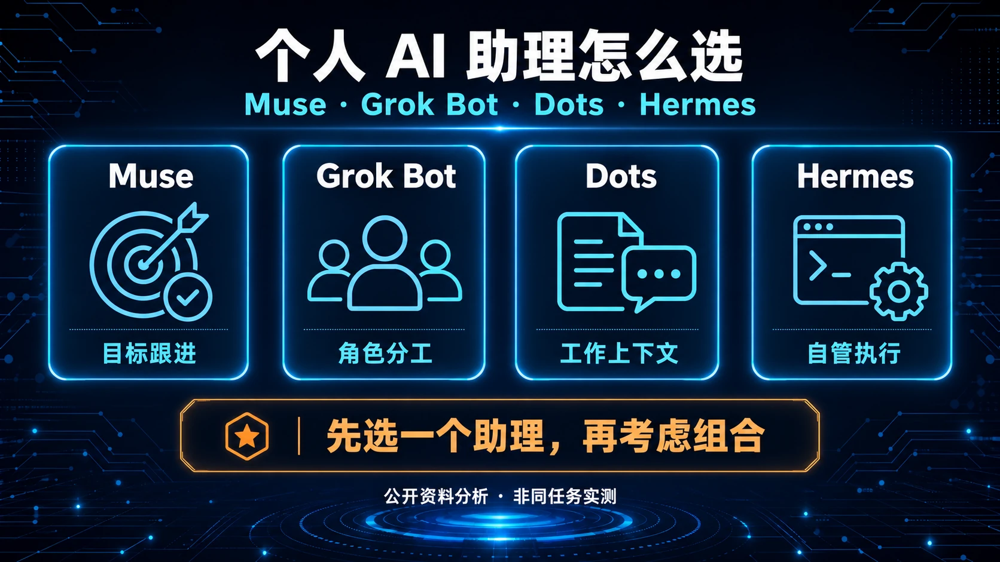
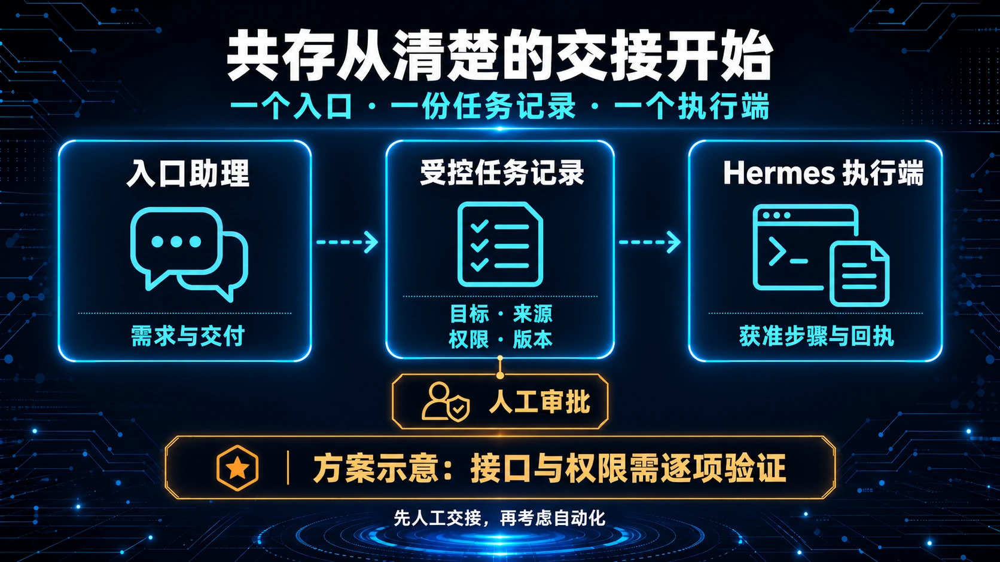
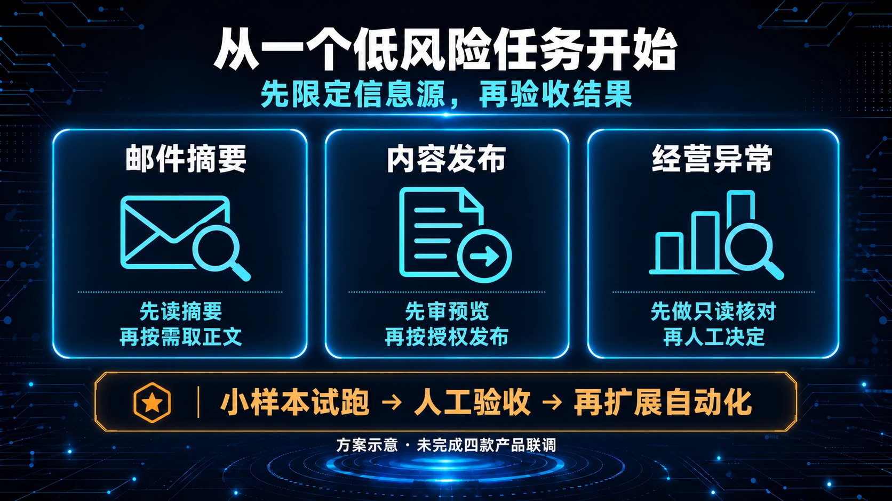

# 🧭 07-个人 AI 助理怎么选：Muse、Grok Bot、Dots 与 Hermes 的分工和共存

**个人 AI 助理专题 · 第 1 篇**  
核验日期：2026 年 10 月 19 日  
适用读者：想用 AI 持续处理工作的小企业经营者、独立开发者与 Agent 开发者

早上打开电脑，客户邮件改了交付要求，昨天写好的文章需要重做配图，运营表格还没更新。你希望助理把事情接过去，下午只回来问两个确实需要你决定的问题。

这样的需求，Muse、Grok Bot、Dots 和 Hermes 都能参与。选择时值得先问三件事：谁负责持续跟进，工作实际在哪台机器上完成，出了问题由谁查明并恢复。

对多数个人和小团队，先用好一个助理就够了。已经能正常使用托管产品、又不想维护运行环境，可以从 Muse、Grok Bot 或 Dots 中选一个；需要掌握模型、执行环境和业务接口，可以考虑 Hermes。只有当现有助理的交互体验和自管执行各有明确价值时，再组合成“一个入口加一个执行端”。

本文依据官方公开文档与发布记录分析能力和边界，没有进行四款产品的同任务性能测试。后半部分的协作流程是参考设计，不代表四家已经提供原生互通协议。文中的 Muse 指 Meta 个人 Agent，Grok Bot 指 xAI 产品，不是 Groq，也不同于普通 Grok 聊天应用。

## 先从你要完成的事开始选

| 你当前最需要什么 | 可以先考虑的路线 | 开始前先核实 |
| --- | --- | --- |
| 日常事务有人长期跟进，尽量少维护系统 | 一个已在你地区和账号开放的托管助理 | 支持地区、实际额度、必要应用能否连接 |
| 已经在 Cursor 工作，希望安排有分工的长期 Bot | Grok Bot | 模型由平台路由、共享云电脑边界、超额计费 |
| 工作主要在 ChatGPT、Work、Codex 与已连接应用中 | Dots | 账号开放资格、工作用量、企业权限 |
| 想接国内模型、自己掌握工具和数据处理链路 | Hermes | 模型工具调用能力、部署运维、审批与凭据管理 |
| 既要方便的对话入口，又要接自有业务系统 | 一个托管助理配 Hermes | 交接接口是否存在、最小数据范围、唯一执行者 |

这是基于产品设计的选择建议，不是任务成功率排名。某个产品能浏览网页，也不等于它能稳定登录你公司的系统；某个模型能聊天，也不证明它能可靠调用业务工具。

## 四者承担的责任不同

### Muse 围绕一个人的目标持续工作

Meta 将 Muse 设计成长时间保留上下文的个人助理：有自己的云端电脑、浏览器和文件系统，可以同时推进任务，并根据计划或相关事件继续工作。用户能查看活动、管理目标和调整主动程度。它适合先交代目标，再通过同一段关系逐渐形成工作习惯。[Muse 设计说明](https://introducing.muse.ai/)

Muse for Small Business 在同一产品上增加面向经营者的技能与连接器，列举了 Shopify、QuickBooks、Canva、Slack 等工具。可以据此评估已有软件组合，但不能直接推导为支持国内所有电商、财务和内容平台。[Muse 商业用途页](https://muse.ai/business)

### Grok Bot 强调有明确分工的长期 Bot

Grok Bot 允许建立有名字、职责和持续上下文的 Bot，产品内的 Bot 可以并行工作、相互发消息和交接任务。对“研究、内容、技术支持分别有人负责”的团队，这种组织方式比较直观。技能保存做事方法，routine 决定何时运行。[产品概览](https://docs.x.ai/grok-bot/overview)、[技能与例行任务](https://docs.x.ai/grok-bot/skills-routines-and-automations)

这里有一个容易忽略的条件：同一用户账号的多个 Bot 共用云电脑。角色和对话可以分开，文件、浏览器会话和命令行凭据仍可能在 Bot 之间共享。给两个 Bot 起不同名字，不能建立安全隔离。[审批与共享电脑边界](https://docs.x.ai/grok-bot/approvals-security-and-privacy)

### Dots 把持续助理接进 ChatGPT 工作体系

Dots 是 OpenAI 的持续 Agent，能利用云电脑、浏览器和连接应用推进项目。当前帮助页明确支持在 iOS、Android、桌面 App 和桌面网页创建 dot，移动网页不支持。它可利用 ChatGPT 记忆与相关工作上下文；具体任务仍有自己的对话，不自动获得所有历史内容。对已有 ChatGPT 工作资料的用户，这能减少一部分重复交代背景的工作。[当前入门说明](https://help.openai.com/en/articles/20001530-getting-started-with-your-dot)、[任务与上下文](https://learn.chatgpt.com/docs/dots/tasks-and-memory)

“能够持续工作”仍受额度、连接状态与权限约束。企业端的 Microsoft Teams 接入目前是邀请制 alpha；发布公告中的更多 dot、专项企业试点等，也要按各自开放状态理解。[企业管理指南](https://learn.chatgpt.com/docs/enterprise/dots-admin-guide)、[发布公告](https://openai.com/index/introducing-dots/)

### Hermes 让你自行组合模型与执行系统

Hermes Agent 是开源 Agent 运行系统。你可以选择模型 provider、工具、执行后端和使用入口，也可以选择官方 Cloud 托管。部署地点、模型供应商和日常运维责任因此有更多组合方式。[模型接入文档](https://raw.githubusercontent.com/NousResearch/hermes-agent/v0.22.2/website/docs/integrations/providers.md)、[Hermes Cloud](https://portal.nousresearch.com/cloud)

它的记忆、会话检索和可更新 skill，有助于积累偏好与做事方法。这里的“学习”主要体现为持续状态与流程知识更新，不能据此宣称基础模型自动训练了权重，或每次执行都会变得更可靠。[记忆文档](https://raw.githubusercontent.com/NousResearch/hermes-agent/v0.22.2/website/docs/user-guide/features/memory.md)、[Skills 文档](https://raw.githubusercontent.com/NousResearch/hermes-agent/v0.22.2/website/docs/user-guide/features/skills.md)

**版本提醒：截至 10 月 19 日，本次核验的最新正式版为 v0.22.2，发布于 10 月 15 日。** 官方说明 v0.22.1 从错误提交构建，混入尚未发布的 gateway 工作，并可能让 Microsoft Store 应用卡在 Connecting；v0.22.2 回到应有的发布线。它修复了重启后 gateway 误判旧 PID、部分本地模型长请求与休眠后的超时问题。已在 v0.22.1 gateway 运行过的会话，在 v0.22.2 仍存在无法删除的已知问题。main 独有工作留待 v0.23.0，不能提前算作稳定版能力。本篇 Hermes 细节链接固定到 v0.22.2；本轮没有安装或运行验证。[正式发布记录](https://github.com/NousResearch/hermes-agent/releases/tag/v0.22.2)

## 记忆和后台任务能帮到哪一步

四者都涉及长期上下文，使用时需要把“记得”“按时运行”“真正完成”分别验收。

| 产品 | 公开资料确认的长期能力 | 工作中要检查的边界 |
| --- | --- | --- |
| Muse | 跨对话记忆、目标跟进、计划或事件触发的后台工作 | 记忆是否最新，具体动作是否已批准，当前连接是否有效 |
| Grok Bot | 角色记忆、技能、routine，Bot 内部协作 | 多 Bot 的共享资源、任务负责人、旧事实是否回查 |
| Dots | 持续任务、自身记忆、部分来源事件与固定计划 | 连接应用不自动等于开启监控；停止主助理不一定取消委派工作或未来排程 |
| Hermes | 持久记忆、会话检索、skill 与 cron | 记忆是否实际写入；调度进程、宿主和投递渠道是否可用 |

Muse 提供记忆管理功能；Grok Bot 官方建议重要决策回查原始来源；Dots 的自身记忆与 ChatGPT memory 是不同层；Hermes 的内置记忆有容量上限，也依赖真实工具写入。它们都不适合作为客户合同状态、库存、价格等动态事实的唯一依据。[Muse 设计](https://introducing.muse.ai/)、[Grok Bot 记忆](https://docs.x.ai/grok-bot/bots)、[Dots 任务与记忆](https://learn.chatgpt.com/docs/dots/tasks-and-memory)、[Hermes 记忆](https://raw.githubusercontent.com/NousResearch/hermes-agent/v0.22.2/website/docs/user-guide/features/memory.md)

对定时任务，至少确认三次：保存计划成功、到期确实执行、结果送到正确位置。Hermes 的 cron 需要相应服务持续运行；本机睡眠或服务停止会影响工作。托管助理能在你的笔记本关闭时继续云端任务，也仍可能遇到网站失效登录、额度用尽和待审批。[Hermes cron](https://raw.githubusercontent.com/NousResearch/hermes-agent/v0.22.2/website/docs/user-guide/features/cron.md)、[Grok Bot 电脑与应用](https://docs.x.ai/grok-bot/computer-and-apps)

## 会用电脑时先确认是哪台电脑

云端电脑、自己的电脑和模型推理服务，是三个需要分别核对的位置。

Muse 的默认工作环境是个人云端 VM。Grok Bot 的主要运行环境也由平台托管；官方当前不支持把 Grok Bot 本体部署在客户自有机房或自带镜像中。它对用户电脑执行命令的授权另行管理。[Muse 安全说明](https://research.meta.ai/blog/security-and-safety-for-ai-agents-our-approach-with-muse)、[Grok Bot 安全 FAQ](https://docs.x.ai/grok-bot/security-faq)

Dots 可以连接用户电脑，但这项连接需要单独授权；本地任务要求该电脑在线、应用开启。云端已经登录某网站，不等于本机也已登录，反过来也一样。[Dots 电脑与应用](https://learn.chatgpt.com/docs/dots/computers-and-apps)

Hermes 的终端、浏览器和 computer use 随执行后端及配置而变。桌面窗口连接远端后端时，文件可能在服务器上，点击发生在对应的远端屏幕；打开桌面 App 不自动证明工具正在操控眼前的电脑。[Hermes 工具后端](https://raw.githubusercontent.com/NousResearch/hermes-agent/v0.22.2/website/docs/user-guide/features/tools.md)、[Computer Use](https://raw.githubusercontent.com/NousResearch/hermes-agent/v0.22.2/website/docs/user-guide/features/computer-use.md)

开始业务任务前，先让助理说明运行主机、工作目录、目标账号和将改变的对象。确认这些通常比事后追问“文件去哪了”更省时间。

## 模型选择决定了哪些东西由你控制

Muse 个人 Agent 与 Muse 模型系列要分开看。Meta 在 10 月 12 日发布 Muse Wonder 与 Wonder Full：Wonder 当时已进入 Meta Model API 和 Muse Code，Wonder Full 当时面向 Muse Code 订阅；公告只明确 Wonder 将很快进入消费者 Muse，先向订阅者推出；未同样承诺 Wonder Full 的消费者入口。本轮未找到足以确认所有个人 Agent 账号已完成切换，或能自由选择第三方模型的公开证据。Active Memory、Active Focus 等能力也应按模型公告理解，不能直接变成个人助理实测结论。[10 月 12 日模型公告](https://about.fb.com/news/2026/10/introducing-muse-wonder-models/)

Grok Bot 由平台选择模型，没有面向客户的模型选择器。不过，官方页面对可见性和企业控制的表述存在冲突：模型帮助页写逐请求模型不可见、Cursor 模型名单不适用；10 月 12 日更新的安全页则写用量分析可展示实际模型与故障切换，并称 Enterprise 白名单默认遵守，但不保证执行。本文不把任一说法外推到所有账号；如果采购要求限定模型供应商或逐请求审计，必须核对具体套餐、配置和书面承诺。[模型帮助页](https://cursor.com/help/grok-bot/models)、[当前安全页 Models and data](https://docs.x.ai/grok-bot/security)

Dots 官方说明使用 GPT-6 Astra。本次没有核实到自由选择第三方模型、BYOK 或自托管主 dot 的公开支持；Enterprise 的现有模型控制和默认模型设置也不适用于 Dots。[Dots 文档](https://learn.chatgpt.com/docs/dots)、[管理指南](https://learn.chatgpt.com/docs/enterprise/dots-admin-guide)

Hermes 可选择云 API 或 Ollama、vLLM 等自托管端点，但必须验证上下文、工具调用、视觉和协议兼容性。官方文档对工具型本地模型的上下文窗口有要求，能返回一句话不等于已经适合完整 Agent 流程。[Hermes provider 文档](https://raw.githubusercontent.com/NousResearch/hermes-agent/v0.22.2/website/docs/integrations/providers.md)

因此，模型锁定也影响成本记录、数据接收方和故障定位。想降低迁移成本，可以把关键业务规则、样例、验收与输出格式保留在可导出的文档或代码中，同时记录产品、工具与可见的模型版本；平台未披露的底层模型标为未知。

## 费用要按完整任务计算

下面是核验日的公开信息，不是对某个账号的最终报价，也不能用来把不同产品的 token 额度直接换算。

| 产品 | 当前公开计费线索 | 容易漏算的部分 |
| --- | --- | --- |
| Muse | 有免费额度；Power 标为 $20/月、5亿 Muse tokens/周；Maximum 为 $100/月、30亿/周 | 免费额度具体数字和 Muse token 换算口径未核实；地区、账号、税费与页面币种需确认 |
| Grok Bot | 10月12日新 X Subscription 的 Premium、Super、Ultra 包含；Plus 不包含；未迁移旧订阅另按旧权益 | 新套餐与 Grok、Cursor 共用周额度；旧套餐、合并迁移和额外用量不能混算 |
| Dots | 首个 dot 随符合资格的 Pro 或 Business Premium 包含；Business Premium 当前美元报价月付125美元/席/月、年付折合100美元，工作区至少两个付费席位，可混合Standard与Premium | 深度工作额度未给统一数字；委派 Work/Codex 按相应口径计量；首月待遇不能当长期承诺 |
| Hermes | 软件 MIT 开源；自管模型、工具和主机，或选官方 Cloud | 推理、搜索/浏览等工具、运行与存储、维护及返工时间 |

来源：[Muse 订阅](https://www.meta.com/help/subscriptions/1021145227643680/)、[Grok Bot 新套餐](https://docs.x.ai/x-subscription/grok-bot)、[Dots 用量](https://learn.chatgpt.com/docs/dots#access)、[Business 价格](https://help.openai.com/en/articles/8542115-chatgpt-business-general-faq)、[Hermes 许可](https://raw.githubusercontent.com/NousResearch/hermes-agent/v0.22.2/LICENSE)。

Grok Bot 先确认自己处在哪套订阅规则下。10 月 12 日的官方文档说明，新 X Subscription 把 Grok、Grok Bot 和 Cursor 放进共享周额度池；已有订阅可以保持原样，选择合并后不可撤销。8 月公告中“Bot 用量独立”的说法不能继续覆盖新套餐。付费前应在账号页核对权益、剩余额度、额外用量开关和税后金额。[新套餐的 Grok Bot 权益](https://docs.x.ai/x-subscription/grok-bot)

Hermes Cloud 当前 FAQ 已不再公开列出旧稿中的 Standard/Pro 固定日价，而是引导到 Portal 查询实例大小与报价。本轮能确认：运行时按实际运行时间计计算资源费并加存储费，停止后仍计存储，推理和工具另算。因此不沿用旧日价，也不把“空闲缩容”理解为所有费用归零。[Hermes Cloud 当前 FAQ](https://portal.nousresearch.com/cloud)

比较时，可以连续记录一周：完成了哪些任务，花费多少，人工检查用了多久，哪些任务返工。只有输入范围和验收一致，“每个已验收任务的成本”才有参考价值。

## 国内读者先检查地区再讨论体验

- Muse：官方地区文案尚不完全一致，部分当前页面列美国与加拿大，另有 Meta 官方公告列美国、加拿大、墨西哥。本轮不把其中任何一页写成无条件的全球完整清单；需以所用入口、地区与实际账号资格复核。未找到中国大陆正式开放的足够官方证据。[商业用途页](https://muse.ai/business)、[Meta Connect 法语公告](https://about.fb.com/fr/news/2026/09/meta-connect-2026-meta-annonce-de-nouvelles-lunettes-ia-des-nouveautes-pour-muse-et-les-meta-vr-glasses/)
- Dots：Pro 当前限18岁以上，排除欧洲经济区、英国和瑞士；Business Premium 面向 ChatGPT 支持地区，且仍逐步开放。中国大陆未在官方 ChatGPT 支持地区清单中；Business Premium 文案中的全球范围应结合该清单理解。[支持地区](https://help.openai.com/en/articles/7947663-chatgpt-supported-countries)、[Dots 资格](https://help.openai.com/en/articles/20001530-getting-started-with-your-dot)
- Grok Bot：本轮没有找到足以确认中国大陆完整产品可用性的官方清单。支持中文界面或某个 Grok 模型，不足以证明 Grok Bot 账号、应用、连接器和计费在当地均可用。[官方入门](https://docs.x.ai/grok-bot/get-started)
- Hermes：自主管理部署与 provider 提供了更多路径，但模型供应商、依赖下载、消息渠道和外部网站仍有各自条件。采用国内可用服务时，也要在实际运行后端验证，不能只测自己的浏览器。

没有满足正式使用条件的托管产品，可以先从 Hermes 的现有国内落地路径开始。不要让一个暂时不可用的入口阻塞整个工作流。

## 数据与凭据需要分层看

### 托管助理的安全表述有适用范围

Muse 的 Secure VM 和安全凭据流程旨在减少模型直接看到秘密的机会；官方技术说明仍保留为支持、安全与运营访问数据的可能。Confidential VM 处于小范围可信测试，当前帮助页也将普通用户可选环境描述为未来功能，不能写成所有用户已享有“Meta 也无法访问”。[技术说明](https://research.meta.ai/blog/security-and-safety-for-ai-agents-our-approach-with-muse)、[当前隐私帮助](https://www.meta.com/en-gb/help/artificial-intelligence/1047255454427887/)

Grok Bot 的云电脑目前在美国，官方同时提醒这不等于自动加入 Cursor 的 US-only data residency 项目。模型路由可能涉及分处理方；使用团队 Privacy Mode 等控制时，也要按对应协议理解。多 Bot 的共享会话与文件尤其不适合隔离不同客户的敏感项目。[Grok Bot 安全文档](https://docs.x.ai/grok-bot/security)

Dots 的网站登录流程可提供私密表单，由用户填写凭据并发送至远程浏览器，不放进普通对话。断开插件只阻止后续访问，已吸收的信息并不因此自动消失；其自身记忆、外部文件和其他 ChatGPT 记忆需分别管理。[电脑与登录](https://learn.chatgpt.com/docs/dots/computers-and-apps)、[隐私 FAQ](https://help.openai.com/en/articles/20001529-dots-privacy-security-and-safety-faqs)

具体到退出或换工具，Dots 当前 FAQ 说明不能直接逐条查看、删除或修改 dot 自身记忆；完整清除其上下文需删除 dot。ChatGPT 的共享记忆、Library 文件、Codex 任务及已写入外部系统的内容另行管理。新入门页把 Reset 描述为删除该 dot 的对话、保存记忆和定时任务；操作前仍须保存结果并阅读当次删除提示。断开邮箱连接不能代替删除已经保留的信息。[记忆与删除范围](https://help.openai.com/en/articles/20001529-dots-privacy-security-and-safety-faqs)、[Reset 说明](https://help.openai.com/en/articles/20001530-getting-started-with-your-dot)

Muse 的删除操作同样不能只看名字。官方帮助说明，删掉一条聊天消息后，相关记忆仍可能存在；要求忘记属于尽力查找和删除，Reset 则会永久清空其状态。已经发出的邮件等外部动作不能靠 Reset 撤回。[Muse 数据管理](https://www.meta.com/help/artificial-intelligence/2225571704857152/)、[批准与指导](https://www.meta.com/help/artificial-intelligence/1385290430137537/)

### Hermes 的控制权同时带来维护责任

Hermes 在本机执行，也可能把任务文本、邮件摘要、工具结果或截图发给云模型。MCP 服务和浏览器后端还可能引入其他接收方。想判断数据是否离开设备，要沿着每一段调用检查，而不能只看安装位置。[MCP 文档](https://raw.githubusercontent.com/NousResearch/hermes-agent/v0.22.2/website/docs/user-guide/features/mcp.md)、[浏览器后端](https://raw.githubusercontent.com/NousResearch/hermes-agent/v0.22.2/website/docs/user-guide/features/browser.md)

Hermes 提供危险命令检查等机制，但官方明确这些保护不构成完整安全隔离；终端仍可能以宿主用户身份运行。敏感业务应同时用独立账号、受限环境、最少工具与可撤销凭据控制风险。[安全文档](https://raw.githubusercontent.com/NousResearch/hermes-agent/v0.22.2/website/docs/user-guide/security.md)

一个实用原则是：入口助理只拿足够理解任务的信息；业务执行端持有完成特定动作所需的最小权限；模型收到的工具结果也要控制范围。只读降低了误修改风险，仍然可能暴露信息。

Hermes 的持久记忆也要明确治理。v0.22.2 文档区分内置记忆、用户画像、历史会话检索与外部记忆提供方；关闭内置存储不会自动关闭外部记忆服务。记忆写入可以配置审批，默认行为与审批开启后的行为不同。若要迁移或停用，应分别检查这些存储和备份，不能只删一份偏好文件就宣称所有历史已清除。[固定版本记忆说明](https://raw.githubusercontent.com/NousResearch/hermes-agent/v0.22.2/website/docs/user-guide/features/memory.md)

## 共存从一个入口和一份任务记录开始

假设你已经有一个用得顺手的托管助理，又希望让 Hermes 接入自己控制的工具。可以先按下面的分工设计：

1. 入口助理负责接收需求、研究公开资料、提炼问题和交付结果
2. 一份受控任务记录保存目标、来源、输入版本、负责人、状态和审批范围
3. Hermes 只执行获准的业务步骤，产出文件、变更预览或执行回执
4. 人处理必要审批；结果确认后，由入口助理统一通知

这是架构建议。Muse、Grok Bot、Dots 与 Hermes 之间的自动交接，需要逐对验证接口、身份认证、权限和失败恢复。Grok Bot 产品内部能互相发消息，不能证明它可以直接指挥其他三者。Hermes 支持 MCP 客户端，文档也提供范围有限的 MCP server 能力，但“同样谈到 MCP”仍不证明具体客户端已经可以互接。[Grok Bot 内部协作](https://docs.x.ai/grok-bot/chat-and-collaboration)、[Hermes MCP](https://raw.githubusercontent.com/NousResearch/hermes-agent/v0.22.2/website/docs/user-guide/features/mcp.md)

第一版可以由人复制一张脱敏任务卡，完全不必先搭接口。任务卡至少写清：目标、输入来源、允许做什么、必须停在哪、谁执行、输出在哪里、如何验收。只有人工交接已经稳定，自动化才有值得保存的流程。

## 三个可以从小做起的场景

以下均为实施方案示例，未声明已完成四款产品联调。

### 场景一 QQ 邮件变成每天的待办摘要

**目标：** 找到需要处理的邮件，保留来源，避免自动答应客户的要求。

可以让 Hermes 在受控环境读取必要摘要，入口助理帮助解释和安排优先级。若原文不允许发给额外平台，就把分析留在获准的环境，只转交脱敏结论，或者完全使用 Hermes。

这里可研究第三方项目 [QQ Mail MCP v0.1.0](https://github.com/zcweah1981/qq-mail-mcp/releases/tag/v0.1.0)。它是面向 Windows + Codex 的早期本地版本，公开提供连接状态、增量摘要、搜索和按需正文四项只读能力。本次同时复核了项目公开 README：它不提供发信、删除、移动、附件下载、远程 HTTP 连接器或内置定时通知。其他 MCP 客户端仍未实测；不能写成 Hermes 官方 QQ 插件或现成自动收件助理。公开版本和任何本地未公开开发必须分栏记录；本地存在某项功能，不代表读者下载 v0.1.0 就能使用。

最小步骤：

1. 用测试邮箱或少量明确获准的邮件，先核对连接和四个工具是否实际可用
2. 验证 Hermes 能否启动该 stdio 服务并调用工具；这一步没通过，就停在接入问题，不开始全天候监控
3. 先读摘要，选中邮件后再读正文；输出事项、来源ID、依据、截止日期和待确认问题
4. 人工抽查；通过后再另设调度和投递记录，避免把扫描确认误当通知已送达

验收时检查是否误改已读状态、是否重复提醒同一封邮件、没有截止日时是否擅自补日期。还要验证末页 ACK、重启重放与 UIDVALIDITY 变化的处理。公开项目将 ACK 定义为推进读取游标；它不证明摘要已经送到用户，更不证明用户看过通知。停用时也要区分卸载客户端与在 QQ 邮箱撤销授权码。公开项目还提醒：QQ 授权码本身不是平台级只读权限，返回云模型的邮件内容可能离开设备。[项目能力与数据边界](https://github.com/zcweah1981/qq-mail-mcp)

### 场景二 一篇网站文章形成三个平台的推广稿

**目标：** 每周维护一篇可靠的主文，再分别适配公众号、小红书和知乎。

入口助理适合收集官方更新、提出结构、整理反馈。Hermes 可以在受控内容目录中检查链接、整理素材和生成待审文件。发布由一个指定执行端负责，避免两个助理分别把相似稿件提交出去。

最小步骤：

1. 确定唯一主稿与版本号，记录来源、事实核验日期和图片许可
2. 先完成主稿，再按各平台读者重写开头、顺序、配图和行动建议
3. 输出发布预览，让人核对账号、标题、正文、图片与可见范围
4. 按授权发布，随后回查实际页面，保存网址与回执；失败或超时先查是否已发布

验收不是只看文件是否生成。还要检查平台稿有没有把“方案”改成“亲测”，图片有没有暗示不存在的产品界面，链接是否指向正确版本。这里的发布能力取决于具体网站、账号与工具，不承诺四者都能无人工参与地完成所有国内平台发布。

### 场景三 经营者每天只看需要决定的异常

**目标：** 从获准读取的销售表、工单或库存数据里整理异常，让经营者决定下一步。

Hermes 可在自己控制的环境执行确定的查询、校验与汇总，入口助理负责解释变化并整理要问的问题。先用 CSV 或只读视图，通常更容易知道哪里算错了。

最小步骤：

1. 选一种数据源，明确时间范围、币种、重复记录与异常定义
2. 用小样本建立可复算结果，核对总行数、排除行数和总额
3. 助理只生成异常清单、来源和建议，不自动调价、退款或承诺交付
4. 人批准某个具体变更后，交给唯一执行端；回查业务系统结果并记账

遇到缺列、数据过期或口径冲突时，应输出问题清单并暂停。不要用看起来顺畅的分析补齐缺失事实。这个场景既可以只用 Hermes，也可以在明确允许分享哪些结论后再增加托管入口。

## 两个助理合作最容易出问题的地方

### 重复执行要在系统层处理

给两个助理说“不要重复”，不足以应对网络超时和重试。建议每个动作都有任务ID和幂等键，同一客户、同一订单、同一内容版本的同一动作只能认领一次。

任务可经过“待准备、待审批、可执行、执行中、待核验、完成、失败待查”的状态。发生超时时，先查目标系统有没有回执，再决定是否重试。审批要绑定动作、目标与输入版本；标题、金额、收件人或正文变了，旧审批就不应继续沿用。

这些是需要自行实现或在现有业务系统中配置的控制，不是本文已经核实四家都内置的统一机制。

### 提醒也需要一个负责人

研究助理、邮箱助理和执行助理都发现同一件事时，由任务负责人合并后通知用户。只有状态变化、临近明确期限或出现新风险才追加提醒。其余助理回传证据，避免三个聊天窗口同时催同一个决定。

### 记忆只传必要部分

建议把数据放在三个不同位置：

- 客户状态、价格和库存留在业务系统，作为当前事实来源
- 表达方式、沟通习惯和个人偏好由主要入口助理维护
- 可复用的操作步骤和验收条件保存在 Hermes skill 或受控流程文档

交接传本任务必要摘要，附来源和时间。发现冲突先回查原系统，不按“哪个助理更肯定”决定。没有必要把所有私人对话、邮箱历史和登录凭据在四个产品之间全量同步。

### 审批不能在交接中丢失

上游助理拿到的同意，不能自动扩展到另一个平台、另一组数据或新的接收人。任务卡应保存授权的动作范围和需要人工接管的条件，执行端再核对自身权限。停止对话也不代表已经撤销服务授权、取消定时任务或撤回已发内容。[Dots 控制说明](https://learn.chatgpt.com/docs/dots/controls)、[Grok Bot 审批说明](https://docs.x.ai/grok-bot/approvals-security-and-privacy)

## 失败之后，先查外部结果再恢复

长期助理最需要演练的时刻，往往是“看起来停了，但不知道办到哪一步”。建议用下面这张表处理第一次失败：

| 看到的现象 | 先找的证据 | 接下来可以做什么 | 暂时不要做什么 |
| --- | --- | --- | --- |
| 对话显示完成，目标没有结果 | 原任务、产物地址、投递回执、目标账号 | 核查是生成成功、投递失败还是账号看错，再补相应一步 | 直接重跑整项发布或发信 |
| 请求超时、电脑断线 | 外部订单/邮件/文章是否已存在，原动作ID | 确认未完成后才重试；无法确认则标“待核验” | 把超时一律视为失败 |
| 自动化一直没运行 | 时区、下一次时间、服务状态、额度、审批 | 找到阻塞，复核一次受控运行 | 靠加更多重复计划补救 |
| 助理沿用错误记忆 | 原始来源、记忆来源、更新时间 | 修正可编辑层；无法逐条删除时评估重置与保留结果 | 把断开连接当作信息已删除 |
| 升级后异常 | 旧/新版本、发布说明、数据备份、已知问题 | 采用官方支持恢复路径，保护状态再改动 | 不备份就删除状态或猜测降级兼容性 |

这是一套通用运行检查，不代表四款产品实现了相同的恢复机制。Dots 的暂停、停止委派任务、取消未来排程是不同操作；暂停主 dot 不是关闭所有工作，删除也不撤回已经送出的消息。[Dots 控制说明](https://learn.chatgpt.com/docs/dots/controls)

Grok Bot 的 Recover/Update 与 Reset 也要分开。官方建议先尝试重试、恢复和更新，Reset 会回到最近保存的快照，近期未同步工作可能丢失；它不是对第三方系统的回滚。Muse 的公开说明提到 VM 备份，但本轮没有查到足以承诺恢复时限或任意时间点恢复的细节。[Grok Bot 故障恢复](https://docs.x.ai/grok-bot/troubleshooting)、[Muse 安全架构](https://research.meta.ai/blog/security-and-safety-for-ai-agents-our-approach-with-muse)

Hermes 的 cron 文档给出更明确的执行记录：异常中断可能记为 unknown，unknown 不自动重跑；其历史与防重机制也不构成外部副作用恰好执行一次的保证。gateway 重启时任务能否存活还取决于实际运行环境，例如 systemd 用户 scope。普通读者不必立刻配置所有选项，但必须知道“调度任务完成”和“外部业务已成功且只执行一次”仍需分开核验。[v0.22.2 cron 执行与恢复](https://raw.githubusercontent.com/NousResearch/hermes-agent/v0.22.2/website/docs/user-guide/features/cron.md)

### 一张可直接使用的人工任务卡

- 目标：把五封自建测试邮件整理成待办摘要
- 输入：测试样本版本、邮件ID与时间；不含客户真实数据
- 允许动作：读取摘要；按指定ID读取有限正文；生成本地待审文件
- 不在范围内：发送邮件、打开邮件链接、下载附件、修改邮件状态、连接额外平台
- 唯一执行者：本次指定的一个助理；其他助理只审阅结果
- 验收：每个事项有来源；未知日期写“未提供”；重复输入不新增重复事项
- 停止条件：登录过期、工具缺失、范围不明或结果无法核对
- 恢复依据：记录已完成的读取、产物位置与待核查步骤；没有证据就不推定成功

这是示例范围，不构成对任何真实邮箱或真实平台操作的授权。第一轮可以全程手工转交任务卡；只有记录已经清楚，再评估自动接口是否值得建设。

## 七天后用什么决定继续

给所有候选产品同一种低风险任务，保留同一份样本、同一项验收，再记录：合格产物数、人工核查时间、返工原因、订阅与增量费用、是否出现范围外动作。样本小就报告样本小，不把几次成功换成整体可靠率排名。

建议把试用结论写成具体选择：这一周可以独立完成哪种工作；哪种需要人盯着；哪些权限并没有带来足够价值；是否已经能停掉重复入口。只有在第二个助理确实接住第一款做不了的工作时，多加一层才有意义。

## 哪些人不需要同时用四个

每周只有几次写作、检索和整理的人，不必同时维护四套助理。没有独特分工，多出的产品会增加入口和重复记忆。

如果工作主要在自有系统，需要明确的模型路线和部署控制，可以先把 Hermes 单独跑稳。增加托管助理以前，先验证它能减少哪些实际沟通成本。

如果你不想维护服务器、模型接口和故障恢复，而现有托管产品已经能完成目标，就不必为了“更自主”再搭一套无人维护的系统。

对确实需要组合的人，建议第一周只选一个低风险任务：限定信息源、保留人工审批、记录花费和失败，再决定是否增加第二个执行角色。系统越复杂，越需要说明多出的那一层到底解决了什么。

## ➡️ 下一步

先写下一个每周重复发生、输入比较清楚的工作，选一个入口和一个验收结果。能只用一个产品做完，就先保留一个；需要更多部署或业务接口控制时，再引入 Hermes。

如果从 Hermes 开始，可继续看[现成方案](/docs/solutions)和[桌面版教程](/docs/start/personalize/desktop-app)；安装或更新出错时，按[安装与环境排障](/docs/issues/install-environment)定位。这个专题接下来会围绕邮件、任务交接、成本与权限展开，每篇完成一个具体问题。

**资料范围说明：** 本篇为截至核验日的官方公开资料分析。第三方 QQ Mail MCP 以项目自身发布记录为来源，与 Hermes、Meta、xAI、OpenAI 的官方集成分开标注。价格、地区、客户端能力和托管额度可能继续变化，订阅、接入与发布前需回查对应页面。

回到：[现成方案](/docs/solutions) · [办公效率与知识整理](/docs/solutions/office)。
