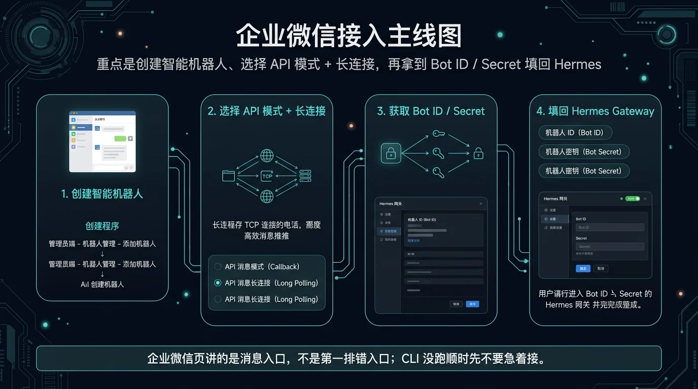
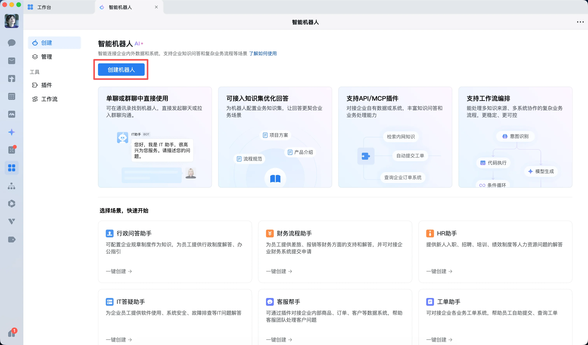

# 企业微信接入指南 (AI Bot)

如果你的团队主协作平台是企业微信，那么这一页将帮你把 Hermes Agent 无缝地“请”进团队，成为每个人的智能助理。

我们将走官方推荐的 **AI Bot 长连接**路线，这种方式无需公网 IP 和复杂的回调配置，稳定又高效。



> **一句话结论**：先在企业微信后台创建 AI 机器人拿到凭据，再把凭据填回 Hermes，启动 Gateway 后发送测试消息，并确认收到 Hermes 回复。

## 🔎 搜索收录速答

本页使用企业微信 **AI Bot 长连接**：在 API 模式选择“使用长连接”，取得 Bot ID 与 Secret，配置 `WECOM_BOT_ID`、`WECOM_SECRET` 后启动 Hermes Gateway，再验证消息收发。Gateway 主动连接企业微信 WebSocket，**无需自建公网 HTTPS 回调地址**；不要把另一条 URL 回调路线的配置要求套到本页。上线前核对凭据、访问权限和连接状态，仅终端没有报错还不能证明消息收发成功。相关入口还可以对比[飞书](/docs/china/entry/feishu)、[钉钉](/docs/china/entry/dingtalk)和[API 服务与 Open WebUI](/docs/china/entry/api-service-open-webui)。


## 🚀 接入三步走

在开始之前，请确保你的 Hermes Agent 至少已经在命令行（CLI）里跑通了。企业微信是消息入口，不是排错的第一站。
如果还没有决定使用哪一种消息或交互入口，先回到[国内入口总览](/docs/china/entry)对比后再继续。

### 第 1 步：在企业微信创建 AI Bot

进入企业微信工作台，找到“智能机器人”功能，创建一个新的机器人。

- **关键点**：选择 **API 模式**，连接方式选择 **使用长连接**。

这是企业微信官方为 Agent 类应用推荐的方式，也是 Hermes 适配器支持得最好的方式。



### 第 2 步：获取凭据

创建成功后，企业微信会提供给你两样关键的东西：
- **Bot ID**
- **Secret**

请妥善保管它们，尤其是 `Secret`，它就像是机器人的密码，绝不能泄露。

### 第 3 步：配置并启动 Hermes Gateway

现在，回到 Hermes Agent 这边。你需要将刚才获取的凭据配置到 `.env` 文件中：

```dotenv
WECOM_BOT_ID=your-bot-id
WECOM_SECRET=your-secret
```

配置好后，启动 Gateway 服务：

```bash
hermes gateway
```

启动后检查 Gateway 的连接与认证状态，再到对应机器人聊天窗口发送一条测试消息，并确认收到 Hermes 回复。终端没有报错不等于接入验收通过；未收到回复时先检查 Bot ID、Secret、网络连接和访问权限。本页仅依据官方资料说明配置流程，未完成企业微信账户联调。

## ⬅️ 上一步

- [05. 飞书接入指南](/docs/china/entry/feishu)

## ➡️ 下一步

- [07. 钉钉接入指南](/docs/china/entry/dingtalk)

## 📖 出处

- [企业微信智能机器人官方文档](https://developer.work.weixin.qq.com/document/path/101059)
- [Hermes 官方 WeCom 长连接文档](https://github.com/NousResearch/hermes-agent/blob/main/website/docs/user-guide/messaging/wecom.md)（2026-11-26 核对长连接与回调路线边界，非账户联调）
- [Hermes Gateway 相关说明](/docs/china/entry/api-service-open-webui)
